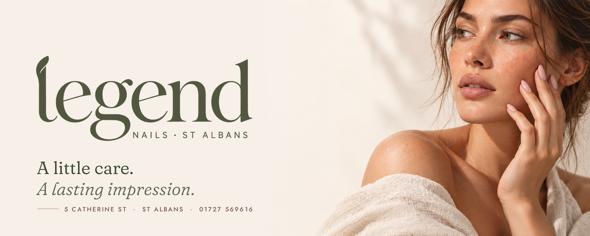
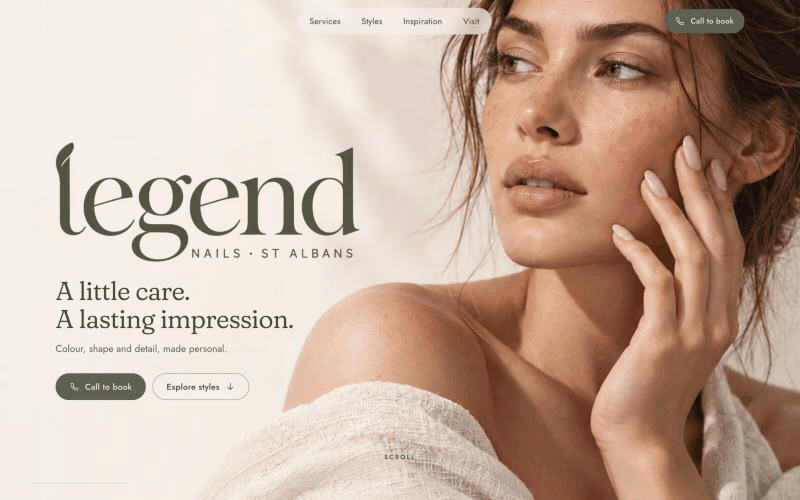
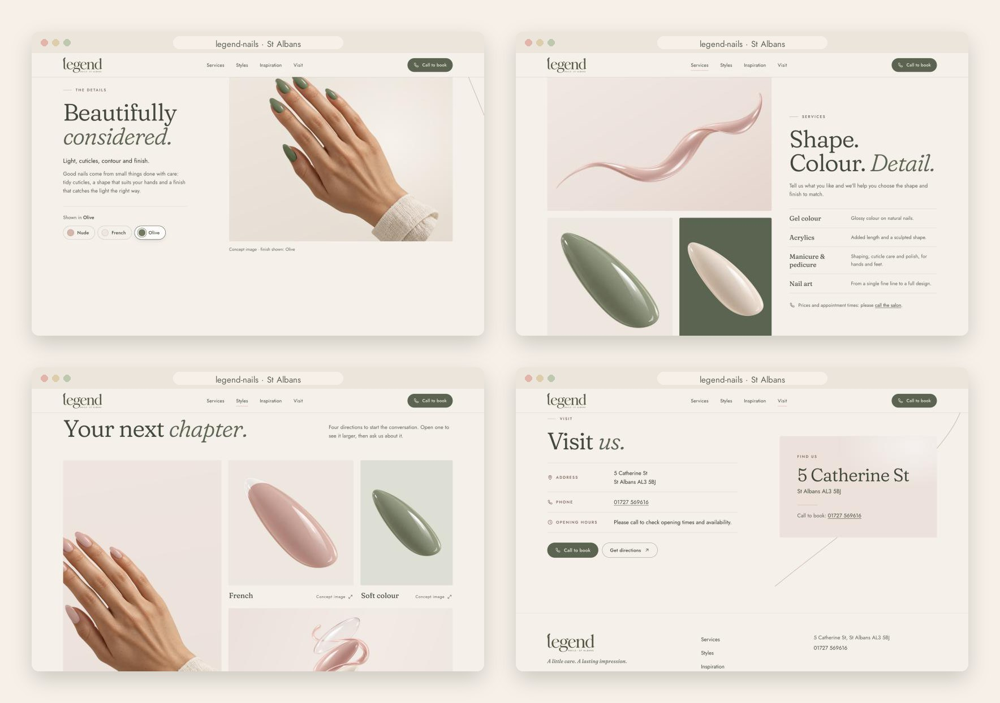
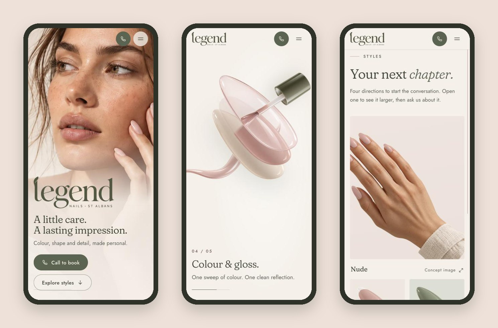

<div align="center">



<h3>A one-page website for a nail salon in St Albans, built around a scroll-driven camera move from a quiet gesture to the detail of a single nail.</h3>

<p>
  <a href="https://legend-nails-st-albans.vercel.app"><strong>🌐 Live site</strong></a>
  &nbsp;·&nbsp;
  <a href="#hero-animation"><strong>🎬 How the hero works</strong></a>
  &nbsp;·&nbsp;
  <a href="#getting-started"><strong>🛠️ Run it locally</strong></a>
</p>

<p>
  <a href="https://legend-nails-st-albans.vercel.app"></a>
  
  
  
  
</p>

</div>

<br />

## 🚀 Overview

**Legend Nails** does manicures, gel colour, acrylics and nail art in St Albans. The site follows the salon's editorial direction (*Direção editorial V2*): soft photography, large serif type, olive, ivory and a touch of pink. Its opening is a single camera move. A portrait with a hand resting on the cheek turns into a macro view of one nail, the nail **separates into base, colour and shine**, a band of polish covers it, one reflection crosses the surface, and the camera pulls back to the **finished hand**, which then settles into the next section.

From there the page breathes: services, a gallery of styles, a nudge to bring your own inspiration, and the address. Every section ends in the same simple action: **call the salon**.

- **Cinematic first impression**: a pinned 2.5D scene made of the kit's own image layers, not a video
- **One choice, everywhere**: pick *Nude*, *French* or *Olive* and the nail, the finished hand, the label and the docked photo all switch together
- **Built for every visitor**: shorter scene on phones, no pinned section and no zoom with reduced motion, full keyboard support and visible focus
- **Honest by default**: no prices, no opening hours and no online booking until the salon confirms them; concept images are labelled as such

<br />

<a name="hero-animation"></a>

## 🎬 The hero animation

<div align="center">
  <a href="https://legend-nails-st-albans.vercel.app"></a>
  <sub>Scroll-scrubbed on the live site · captured at 1440 × 900</sub>
</div>

<br />

The hero stays pinned for about two extra screen heights and follows the scroll script from the brief:

| Scroll  | What happens                                                                                                   |
| :------ | :------------------------------------------------------------------------------------------------------------- |
| 0–20%   | **Gesture**: the portrait, the *legend* wordmark, **Call to book** and **Explore styles**                      |
| 20–40%  | **Closer**: the camera moves in on a nail and goes soft; the wordmark settles into the header; the macro nail takes over at the same size and angle |
| 40–60%  | **Layers**: base, colour and shine lift apart a little, with labels and a very discreet orbit                  |
| 60–80%  | **Colour & gloss**: the brush lays a band of polish from cuticle to tip, the layers realign, one reflection crosses the nail |
| 80–100% | **The finished hand**: the camera pulls back to the hand in the chosen finish, then the hand glides into *Beautifully considered.* |

**Under the hood**

- 🧩 **One smoothed scroll value drives everything.** The scene is a pure function of the scroll position (`render(p)` in `src/js/hero.js`), so it runs backwards as cleanly as forwards and resizes without state to rebuild.
- 📐 **Measured, not guessed.** `npm run images` measures each nail layer's axis on its visible pixels (alpha-weighted PCA), cuts all layers to one shared box so they stay registered, and writes the geometry to `src/data/asset-meta.json`. The nail in the portrait and the nail on the finished hand were measured too, so the hand-overs line up.
- 🪞 **No visible roll.** The portrait's nails point up-left, the kit's macro nails and hand point up-right, so the whole macro world is mirrored once at build time.
- 🎨 **Three finishes from one photo.** The kit has the finished hand in French only. `scripts/hand-variants.py` segments each nail with GrabCut and recolours it in Lab space, keeping the original shading and gloss, to make the nude and olive versions.
- 🖌️ **Paint and light without video.** The band of polish is a CSS mask whose stops follow the brush tip; the reflection is a gradient clipped to the nail's own silhouette.
- 🔁 **Seamless hand-off.** After the pin releases, the hand travels in document space into the frame of the next section, then the section's own image takes over in exactly the same spot.

<br />

## 🖥️ Sections

<div align="center">
  
</div>

<br />

| #   | Section                          | Anchor         | Role                                                                                         |
| :-- | :------------------------------- | :------------- | :------------------------------------------------------------------------------------------- |
| 01  | **A little care. A lasting impression.** | `#top` | First impression, **Call to book** and **Explore styles** from the very first second       |
| 02  | **Beautifully considered.**      | `#considered`  | Narrow text column and the wide hand photo where the hero lands, with the finish picker      |
| 03  | **Shape. Colour. Detail.**       | `#services`    | Mosaic of macro images and the service list: gel colour, acrylics, manicure & pedicure, nail art |
| 04  | **Your next chapter.**           | `#styles`      | Asymmetric gallery (nude, French, soft colour, nail art); a tile opens a larger view with **Ask about this style** |
| 05  | **Bring your inspiration.**      | `#inspiration` | *A colour. A shape. A photo to discuss.*                                                     |
| 06  | **Visit us.**                    | `#visit`       | Address, phone, directions; light footer, no dark block                                      |

A thin pink line, the stroke from the hero, carries on between the sections and is drawn as you scroll.

<br />

## 📱 Mobile first, motion optional

<div align="center">
  
</div>

<br />

- On phones the scene runs on a shorter track, without the orbit and the layer labels
- With `prefers-reduced-motion` there is no pinned section and no zoom: the finished hand and the picker live in *Beautifully considered* and switch directly
- Every touch target is at least 44 px; no horizontal scroll at 375 px
- Without JavaScript the page is complete: static hero, French hand, gallery tiles that open the image

<br />

## ✨ Highlights

- **🎞️ Scroll storytelling**: a written five-step script, scrubbed with a light easing and fully reversible
- **🎨 Single source of state**: one `finishState` updates the macro nail, the finished hand, the docked photo, every picker and a polite live announcement
- **🖼️ Gallery with a purpose**: a native `<dialog>` with focus management, arrow keys, backdrop close and a call button in every view
- **🧭 Calm header**: the wordmark lands in it during the hero; links stay readable over the photo; the current section is highlighted
- **♿ Accessible by construction**: skip link, real headings, labelled controls, `aria-pressed` pickers, hidden-until-animated states that only apply once the code that reveals them is running
- **🖼️ Image pipeline**: the kit's PNGs stay the source of truth; WebP derivatives, geometry, favicon and the social image come from `npm run images`
- **🔎 Ready to share**: Open Graph image and `NailSalon` structured data with the address and phone from the brief

<br />

## 💻 Tech stack

| <br />Vite 6 | <br />JavaScript | <br />HTML5 | <br />CSS3 | <br />OpenCV | <br />Vercel |
| :---: | :---: | :---: | :---: | :---: | :---: |

### Why this stack?

- **Vite + plain JavaScript**: a one-page site doesn't need a framework runtime; the page is static HTML with small, focused modules (about 8 KB of JavaScript, gzipped)
- **No animation library**: the hero is a pure function of one scroll value, so a `requestAnimationFrame` loop and CSS transforms are all it needs
- **sharp + OpenCV for the assets**: measuring, registering and recolouring the kit's images happens once, at build time, not in the browser
- **Self-hosted Fraunces and Jost**: soft serif display type and a light geometric sans, with no third-party font requests
- **Vercel**: every push to `main` deploys automatically; hashed assets are cached for a year (`vercel.json`)

<br />

## 🎨 Design system

| Token       | Value                                                                        | Use                                         |
| :---------- | :--------------------------------------------------------------------------- | :------------------------------------------ |
| Olive       |  | Buttons, wordmark, accents (5.6:1 on ivory) |
| Deep olive  |  | Headings and links                          |
| Ivory       |  | Page background                             |
| Ivory 2     |  | Panels                                      |
| Soft pink   |  | Details, selection                          |
| Pink line   |  | The thread between sections, rules          |

- **Type**: Fraunces (soft axis at 100) for display, 40–76 px headings on desktop; Jost for text, 16–17 px body, uppercase labels tracked at 0.22em
- **Grid**: 1,240 px content width, 12 columns, gutters from 16 to 48 px
- **Rhythm**: 96–176 px between sections
- **Motion**: entrances of 26 px over 900 ms; controls react in 160–220 ms; everything respects `prefers-reduced-motion`

<br />

<a name="getting-started"></a>

## 🛠️ Getting started

```bash
# Clone the repository
git clone https://github.com/Jeanfr1/legendnailswebsite.git
cd legendnailswebsite

# Install dependencies (Node 20.9+)
npm install

# Start the dev server  →  http://localhost:5173
npm run dev

# Production build  →  dist/
npm run build

# Preview the production build
npm run preview

# Regenerate the WebP images and the hero geometry from the PNG sources
npm run images

# Optional, Python 3 (pypdf, Pillow, OpenCV): re-extract the kit / rebuild the hand finishes
python3 scripts/extract-pdf-assets.py
python3 scripts/hand-variants.py
```

<br />

## 📁 Project structure

```
legendnailswebsite/
├── index.html                    # Every section: hero → considered → services → styles → inspiration → visit → footer
├── src/
│   ├── main.js                   # Entry: fonts, styles, module init
│   ├── styles/main.css           # Design tokens, hero modes, sections, responsive rules
│   ├── data/
│   │   ├── finishes.js           # Nude / French / Olive
│   │   └── asset-meta.json       # Measured geometry (generated by npm run images)
│   └── js/
│       ├── hero.js               # Scroll script, camera, layers, paint, reflection, hand-off
│       ├── state.js              # finishState + small math helpers
│       ├── picker.js             # Finish pickers, labels, the docked hand
│       ├── gallery.js            # Lightbox for "Your next chapter."
│       ├── thread.js             # The pink line between sections
│       ├── header.js             # Solid-after-hero header, active link, mobile menu
│       ├── scroll.js             # In-page navigation
│       └── reveal.js             # Section entrances
├── design/source/                # The brief and catalogue (PDF) + the PNGs extracted from it
├── scripts/
│   ├── optimize-images.mjs       # PNG → WebP, layer registration, geometry, favicon, OG image
│   ├── extract-pdf-assets.py     # Pulls the images out of the catalogue PDF
│   └── hand-variants.py          # Nude and olive versions of the finished hand
├── public/                       # Favicon, Open Graph image, gallery images
└── vercel.json                   # One-year cache for hashed assets
```

<br />

## 🚀 Deployment

Hosted on **Vercel** and connected to this repository: every push to `main` ships to production.

**Live site:** [legend-nails-st-albans.vercel.app](https://legend-nails-st-albans.vercel.app)

| Setting          | Value           |
| :--------------- | :-------------- |
| Framework        | Vite            |
| Build command    | `npm run build` |
| Output directory | `dist`          |

<br />

## 📌 Content checklist

Items waiting on the salon. Each one is marked `TODO(legend)` in `index.html`.

- [ ] Approve the short text of **Beautifully considered.**
- [ ] Confirm the services, their descriptions and prices (the 2023 price list is not used)
- [ ] Opening hours, walk-ins and payment methods for **Visit us.**
- [ ] Authorised photos of the salon's own work to replace the concept images in the gallery
- [ ] Vector version of the wordmark for print and very small sizes (the site uses the transparent PNG from the kit)
- [ ] Custom domain (then update `canonical`, `og:url`, `og:image` and the structured data URL)
- [ ] Optional: a produced video or 3D render of the hand for the hero, as the brief suggests, to replace the 2.5D layers

<br />

## 🙏 Acknowledgments

- **Legend Nails** for the brief and the editorial direction
- **[Fraunces](https://fonts.google.com/specimen/Fraunces)** by Undercase Type and **[Jost](https://fonts.google.com/specimen/Jost)** by Owen Earl (both OFL)
- **[Lucide](https://lucide.dev)** for the line icons the interface icons are based on (ISC)
- **[sharp](https://sharp.pixelplumbing.com)**, **[OpenCV](https://opencv.org)** and **[pypdf](https://pypdf.readthedocs.io)** for the asset pipeline
- **[Vite](https://vite.dev)** and **[Vercel](https://vercel.com)**

<br />

---

<div align="center">
  
  <p><strong>A little care. A lasting impression.</strong></p>
  <p>Built with ❤️ by <a href="https://github.com/Jeanfr1">Jean</a> for Legend Nails</p>
  <sub>© 2026 Legend Nails, St Albans. All rights reserved.</sub>
</div>
